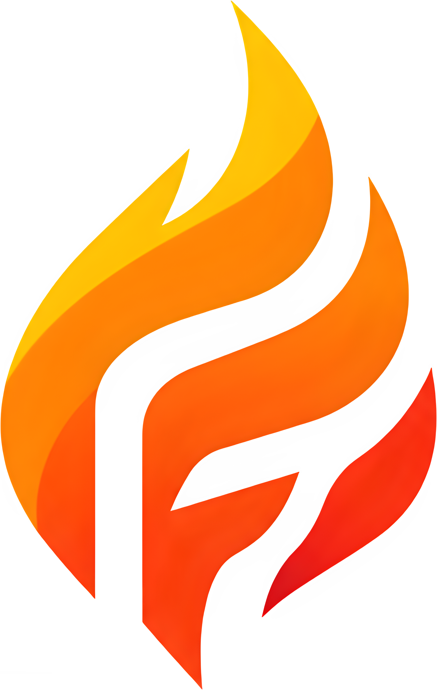

# Fugh IDE

<p align="center">
  
</p>

<p align="center">
  A Linux desktop IDE for <strong>C++</strong> and <strong>C#</strong>, built with Rust, <code>eframe</code>, and <code>egui</code>.
</p>

<p align="center">
  <a href="https://github.com/pilotRL/Fugh">
    
  </a>
  <a href="https://www.rust-lang.org/">
    
  </a>
  <a href="https://github.com/pilotRL/Fugh/blob/main/LICENSE">
    
  </a>
</p>

<p align="center">
  <a href="#what-it-can-do">Features</a> •
  <a href="#requirements">Requirements</a> •
  <a href="#build-and-run-from-source">Build</a> •
  <a href="#install-for-your-linux-user">Installation</a> •
  <a href="#current-limitations">Limitations</a>
</p>

---

Fugh is a Linux desktop IDE for **C++** and **C#**, built with Rust, `eframe`, and `egui`. It brings project browsing, source editing, language tools, build commands, and debugging into one application. Fugh is under active development; support varies by language and project type.

## What it can do

### Projects

- Create C++ CMake console/library projects and C# console, class-library, and Avalonia projects.
- Open project folders, CMake projects, `.csproj`, `.sln`/`.slnx`, and Visual Studio `.vcxproj` files.
- Browse project files, create files and folders, and keep recent projects.
- Open or double-click a `.fugh` project file to reopen its project. Fugh creates a project file when a project is opened. Project-specific IDE settings live in the hidden `.fugh/` folder beside it.
- Import existing projects without converting their source files.

### Editor and language tools

- Edit C++, C#, Rust, JSON, and TOML with syntax highlighting, tabs, folding, minimap, multiple cursors, and editor zoom.
- Find text across project files, navigate symbols, and use document outlines and code actions where supported by the language server.
- Show language-server and build diagnostics in the editor and Problems panel. C++ uses `clangd`; C# uses the Roslyn language server when available.
- Format C++ with `clang-format` and C# with `dotnet format`.
- Configure project-specific C++ include paths, libraries, compiler/linker options, and runtime libraries. C# project properties include framework, runtime identifier, assembly name, nullable settings, NuGet packages, and assembly references.

Language features depend on the matching tools and project metadata being installed and configured. Local completion is a fallback; it is not a replacement for a language server.

### Build, run, and debug

- Build, rebuild, clean, analyze, run, and debug projects; publish and package supported project types.
- Select a build configuration from the toolbar. CMake projects offer Debug, Release, RelWithDebInfo, MinSizeRel, and custom names; custom CMake configurations need matching flags in the project. .NET projects offer Debug, Release, and custom configuration names.
- Select a platform from the toolbar. C# supports Any CPU, x86, x64, and ARM64. C++ supports Host, x86, and x64 with GCC/Clang; x86 builds require the corresponding multilib libraries.
- Debug C++ applications with GDB. C# debugging uses NetCoreDbg on supported Linux architectures.
- Use the debugger controls for continue, stepping, stop, breakpoints, variables, and stack frames.

Imported Visual Studio `.vcxproj` files can be browsed and edited, but Fugh's build runner currently builds C++ projects through CMake. Use CMake for the supported C++ build workflow.

### Interface

- Recent-project welcome screen, configurable themes, editor settings, keyboard shortcuts, and resizable/repositionable panels.
- A lightweight Avalonia designer for a subset of XAML controls. It is not a live application preview.
- Startup splash and a Fugh application icon.

---

## Requirements

Fugh is developed and packaged for Linux desktop environments. Building Fugh from source requires Rust and the native GUI development libraries for `eframe`/`egui`. The current `Cargo.toml` requires Rust 1.95 or newer.

The **Toolchain Setup** window can install common IDE tools from inside Fugh. It uses DNF on Fedora/RHEL-family systems, APT on Ubuntu/Debian-family systems, pacman on Arch-family systems, Zypper on openSUSE/SUSE, and apk on Alpine. Rust and the .NET SDK are installed for the current user with the official [rustup](https://rustup.rs/) and [Microsoft .NET installer](https://learn.microsoft.com/en-us/dotnet/core/install/linux-scripted-manual); the [Roslyn language server](https://www.nuget.org/packages/roslyn-language-server/) is installed as a .NET tool, and NetCoreDbg is downloaded from its [official release feed](https://github.com/Samsung/netcoredbg/releases). System packages require PolicyKit authorization. Other distributions can still use the user-local installers, but system tools must be installed with that distribution's package manager.

To build **Fugh itself** from source, install Rust 1.95 or newer with rustup and the native GUI development libraries for your distribution. Examples:

Fedora:

```bash
sudo dnf group install "Development Tools"
sudo dnf install pkgconf-pkg-config openssl-devel libxcb-devel libxkbcommon-devel \
  wayland-devel mesa-libGL-devel cmake gcc-c++ make
```

Ubuntu and Debian:

```bash
sudo apt-get update
sudo apt-get install build-essential pkg-config libssl-dev libxcb1-dev \
  libxcb-shape0-dev libxcb-xfixes0-dev libxkbcommon-dev libwayland-dev \
  libgl1-mesa-dev cmake
```

Arch Linux:

```bash
sudo pacman -Syu --needed base-devel pkgconf openssl libxcb libxkbcommon \
  wayland mesa cmake
```

openSUSE:

```bash
sudo zypper install -t pattern devel_basis
sudo zypper install pkg-config openssl-devel libxcb-devel libxkbcommon-devel \
  wayland-devel Mesa-libGL-devel cmake
```

The source-build packages above are separate from the optional IDE toolchains. Use **Toolchain Setup** for project tools such as CMake, C++ compilers, clangd, clang-format, GDB/LLDB, Rust, .NET, Roslyn, and NetCoreDbg.

## Build and run from source

```bash
git clone https://github.com/pilotRL/Fugh.git
cd Fugh
cargo build --release
cargo run --release
```

## Install for your Linux user

After building the release binary, run:

```bash
bash packaging/linux/install-user.sh
```

The script installs Fugh under `~/.local`, adds an application-menu entry, installs the Fugh icon, and registers `.fugh` files to open in Fugh. The integration uses the common XDG desktop and MIME standards used by KDE Plasma, GNOME, and other Linux desktops. It requires `shared-mime-info` (`update-mime-database`) and `xdg-utils` (`xdg-mime`) for file association; the installer prints a warning if either command is missing. Then double-click a `.fugh` file to launch Fugh and open that project. You can also start a project explicitly:

```bash
fugh-ide --open-project /path/to/MyProject.fugh
```

## Project files and settings

A `MyProject.fugh` file is a small project launcher. It points Fugh to the associated project file or folder; the source files remain in place. Project-specific Fugh settings, including build configuration and platform, are stored in `.fugh/project-properties.json` under the project root. These settings can be committed with the project if the team wants to share them.

The Linux desktop entry is named `io.github.pilotrl.fugh.desktop` to match the lowercase app ID advertised by the Wayland window. A separate hidden desktop entry maps the splash window ID to the same icon without sharing the IDE's window identity. Keep app IDs and desktop-entry filenames aligned when packaging Fugh. The user installer also places a `Fugh IDE.desktop` launcher and the icon image beside the release binary; Linux ELF executables do not have a portable embedded file icon. Build the release binary on the target distro for the broadest compatibility; this user installer handles desktop integration and does not bundle system libraries.

## Current limitations

- Language-server features require their external servers and project metadata.
- C++ builds use CMake; imported Visual Studio C++ project files are browse/edit only.
- C++ x86/x64 selection relies on GCC/Clang `-m32`/`-m64` support. Cross-compiling for other targets requires a CMake toolchain file.
- C# debugging requires NetCoreDbg and a supported Linux architecture.
- The Avalonia designer covers only a subset of XAML and does not run the app as a live preview.
- In-app system package installation supports Fedora/RHEL, Ubuntu/Debian, Arch, openSUSE/SUSE, and Alpine families; other distributions need manual package installation.
- Rust currently has editor syntax highlighting only; Rust project creation and build/debug workflows are not implemented.

---

## Contributing and bug reports

Report bugs and missing features through the [Fugh issue tracker](https://github.com/pilotRL/Fugh/issues).

<p align="center">
  <a href="https://github.com/pilotRL/Fugh">View Fugh on GitHub</a>
</p>
